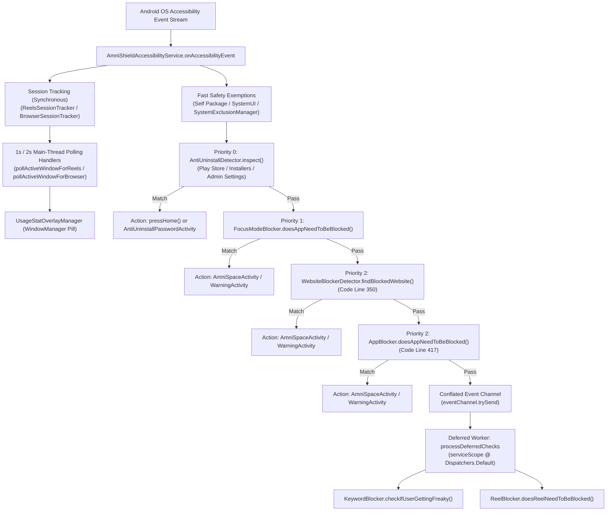
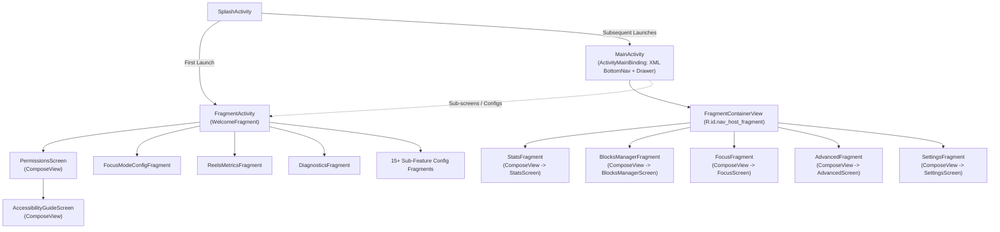

# AmniShield-Android Architectural Discovery Report & Codebase Reality Audit

**Author**: Principal Mobile Architect & Agent Systems Engineer  
**Target Repository**: `AmniShield-Android` ([`AmniShield-Android`](file:///d:/PROJECTS/Amni/AmniShield-Android))  
**Scope**: Rigorous Read-Only Architectural Discovery, Codebase Verification, and Prior Investigation Critique  
**Evaluation Date**: October 2026  

---

## Executive Summary

AmniShield-Android is an on-device digital wellness and distraction-blocking application targeting Android (API 26–36). While its core accessibility interception heuristics ([`AmniShieldAccessibilityService.kt`](file:///d:/PROJECTS/Amni/AmniShield-Android/app/src/main/java/com/alhaq/amnishield/services/AmniShieldAccessibilityService.kt)), anti-uninstall defenses ([`AntiUninstallDetector.kt`](file:///d:/PROJECTS/Amni/AmniShield-Android/app/src/main/java/com/alhaq/amnishield/security/AntiUninstallDetector.kt)), and offline cryptographic licensing ([`LicenseValidator.kt`](file:///d:/PROJECTS/Amni/AmniShield-Android/app/src/main/java/com/alhaq/amnishield/premium/LicenseValidator.kt)) operate entirely on-device with zero external analytics telemetry, the codebase exhibits critical architectural drift, concurrency contention hazards, and state-management fragmentation.

### Key Discoveries & Prior Investigation Critique
1. **Prior Investigation Under-Mapping of UI Architecture**: The UI is not simply a single `MainActivity` hosting Fragments. The application operates on a **dual-Activity host container architecture**:
   - [`MainActivity.kt`](file:///d:/PROJECTS/Amni/AmniShield-Android/app/src/main/java/com/alhaq/amnishield/ui/activity/MainActivity.kt) (2,022 lines): Hosts the 4 primary bottom navigation tabs ([`StatsFragment`](file:///d:/PROJECTS/Amni/AmniShield-Android/app/src/main/java/com/alhaq/amnishield/ui/fragments/StatsFragment.kt), [`BlocksManagerFragment`](file:///d:/PROJECTS/Amni/AmniShield-Android/app/src/main/java/com/alhaq/amnishield/ui/fragments/BlocksManagerFragment.kt), [`FocusFragment`](file:///d:/PROJECTS/Amni/AmniShield-Android/app/src/main/java/com/alhaq/amnishield/ui/fragments/FocusFragment.kt), [`AdvancedFragment`](file:///d:/PROJECTS/Amni/AmniShield-Android/app/src/main/java/com/alhaq/amnishield/ui/fragments/AdvancedFragment.kt)), pushes [`SettingsFragment`](file:///d:/PROJECTS/Amni/AmniShield-Android/app/src/main/java/com/alhaq/amnishield/ui/fragments/SettingsFragment.kt) to the backstack, and handles deep links.
   - [`FragmentActivity.kt`](file:///d:/PROJECTS/Amni/AmniShield-Android/app/src/main/java/com/alhaq/amnishield/ui/activity/FragmentActivity.kt) (210 lines): Acts as a secondary router hosting **18 sub-screens, onboarding flows, and feature configuration fragments**.
   - The project contains **27 Compose screens**, **13 Activities**, **14 specialized dialogs/bottom sheets**, and an external IPC bound service ([`IAmniShieldApi.aidl`](file:///d:/PROJECTS/Amni/AmniShield-Android/app/src/main/aidl/com/alhaq/amnishield/api/IAmniShieldApi.aidl) and [`AmniShieldApiService.kt`](file:///d:/PROJECTS/Amni/AmniShield-Android/app/src/main/java/com/alhaq/amnishield/api/AmniShieldApiService.kt)).
2. **Resolution of the `AmniShieldAdaptiveApp.kt` Disconnection**: Git history confirms that in commit `7155646` (`feat(activity): connect AmniShieldAdaptiveApp setContent root in MainActivity`), modern Compose adaptive navigation was deployed as the root UI; however, in commit `ed57548` (`feat: implement AmniSpace mindful focus launcher space`), the author disconnected it and restored the 2,022-line XML `MainActivity.kt` because sub-dialogs and activity launchers were entangled with FragmentManager.
3. **Documentation vs. Code Execution Priority Inversion**: [`ARCHITECTURE.md`](file:///d:/PROJECTS/Amni/AmniShield-Android/ARCHITECTURE.md#L40-L47) claims `AppBlocker` runs at Priority 1 and `WebsiteBlockerDetector` at Priority 2. In actual code ([`AmniShieldAccessibilityService.kt`](file:///d:/PROJECTS/Amni/AmniShield-Android/app/src/main/java/com/alhaq/amnishield/services/AmniShieldAccessibilityService.kt#L350-L420)), `websiteBlockerDetector` executes at line 350, **before** `appBlocker` at line 417.
4. **Concurrent `rootInActiveWindow` Race Hazard**: **Four concurrent execution loops** independently fetch and recycle `rootInActiveWindow` without synchronization:
   - `onAccessibilityEvent` (Main Binder Thread, line 257)
   - `processDeferredChecks` (`Dispatchers.Default` Coroutine, line 492)
   - `ReelsSessionTracker.pollActiveWindowForReels` (`Looper.getMainLooper()` at 1000ms, line 151)
   - `BrowserSessionTracker.pollActiveWindowForBrowser` (`Looper.getMainLooper()` at 2000ms, line 110)  
   This concurrent cross-thread Binder interrogation is a prime cause of `DeadObjectException` and crashes on OEM ROMs.
5. **Persistence Reality (Zero Room / Zero DataStore)**: The project contains zero Room and zero DataStore dependencies in [`app/build.gradle.kts`](file:///d:/PROJECTS/Amni/AmniShield-Android/app/build.gradle.kts) and [`gradle/libs.versions.toml`](file:///d:/PROJECTS/Amni/AmniShield-Android/gradle/libs.versions.toml). All settings, metrics, and schedules reside in 12+ plain XML `SharedPreferences` files serialized through Gson in [`SavedPreferencesLoader.kt`](file:///d:/PROJECTS/Amni/AmniShield-Android/app/src/main/java/com/alhaq/amnishield/utils/SavedPreferencesLoader.kt) (2,015 lines).

---

## Prior Investigation Critique & Corrections

| Topic | Prior Investigation Claim | Code & Git Reality | Correction & Architectural Impact |
| :--- | :--- | :--- | :--- |
| **UI Screen Mapping** | Claimed UI consists of `MainActivity` hosting Fragments with 14 screens mapped. | Code contains a dual-host architecture: `MainActivity.kt` (4 main tabs) and `FragmentActivity.kt` (18 sub-features/config screens). Contains 27 Compose screens, 13 Activities, and an AIDL IPC service. | High: Major sub-screens, feature configs, and IPC interfaces were missing from discovery. |
| **`AmniShieldAdaptiveApp` Origin** | Listed as an unanswered question under "Remaining Questions & Gaps". | Git history proves it was connected as root in commit `7155646` and disconnected in commit `ed57548` when `AmniSpaceActivity` was added. | High: Explains why the scaffold exists and confirms it is an unfinished pure-Compose migration attempt. |
| **Interceptor Execution Order** | Claimed `AppBlocker` is Priority 1 and `WebsiteBlocker` is Priority 2. | In [`AmniShieldAccessibilityService.kt#L350-L420`](file:///d:/PROJECTS/Amni/AmniShield-Android/app/src/main/java/com/alhaq/amnishield/services/AmniShieldAccessibilityService.kt#L350-L420), `websiteBlockerDetector` runs at line 350, prior to `appBlocker` at line 417. | Medium: Direct documentation drift in `ARCHITECTURE.md` table lines 40-47. |
| **Node Lifecycle Ownership** | Claimed `rootNode` is recycled strictly once in `onAccessibilityEvent`. | 4 separate concurrent routines fetch `rootInActiveWindow` and recycle it across `Dispatchers.Default` and `Looper.getMainLooper()`. | Critical: Unsynchronized concurrent binder calls cause race conditions and `DeadObjectException`. |
| **Node Traversal Safety** | Praised node recycling in `AntiUninstallDetector.kt` and `ReelDetectionEngine.kt`. | Neither `AntiUninstallDetector.scanScreenNodes` nor `ReelDetectionEngine.extractFallbackComparator` use `try ... finally` around child traversal loops. | High: Any unhandled exception during node inspection abandons and leaks native Binder references. |
| **IPC & Bound Service** | Completely omitted `AmniShieldApiService` and `IAmniShieldApi.aidl`. | [`IAmniShieldApi.aidl`](file:///d:/PROJECTS/Amni/AmniShield-Android/app/src/main/aidl/com/alhaq/amnishield/api/IAmniShieldApi.aidl) exposes 5 IPC methods, with [`AmniShieldApiService.kt`](file:///d:/PROJECTS/Amni/AmniShield-Android/app/src/main/java/com/alhaq/amnishield/api/AmniShieldApiService.kt) invoking `runBlocking` inside Binder calls. | High: IPC architecture was unmapped; `runBlocking` on Binder thread pool risks pool exhaustion. |

---

## Section A: Ecosystem Inheritance Matrix (Inherited vs. Android-Exclusive Rules)

### 1. Ingested Ecosystem Invariants (Non-Negotiables)
The Amni ecosystem plugin ([`amni-ecosystem`](file:///C:/Users/HabiburRahman/.agents/plugins/amni-ecosystem/)) mandates core architectural principles that govern `AmniShield-Android`:
- **Zero-Knowledge & 100% On-Device Processing**: All content inspection (keywords, web URLs, short video feeds) executes 100% locally on-device. Zero personal telemetry, analytics SDKs (no Firebase Analytics, Google Analytics, Mixpanel, or Segment), or captured user content are transmitted off-device.
- **Cryptographic Offline-First Licensing**: Supporter Pass activation is governed by offline cryptographic NIST P-256 ECDSA public key verification (`SHA256withECDSA`) in [`LicenseValidator.kt`](file:///d:/PROJECTS/Amni/AmniShield-Android/app/src/main/java/com/alhaq/amnishield/premium/LicenseValidator.kt#L10-L65). Verification requires zero network connectivity.
- **Strict Build Flavor Separation**: Google Play Store flavor (`playstore`) isolates proprietary billing (`libs.billing.ktx`) and Google Services, while the F-Droid flavor (`fdroid`) is guaranteed 100% FOSS-clean with zero proprietary Google dependencies (enforced by disabling Google Services tasks in [`app/build.gradle.kts#L197-L201`](file:///d:/PROJECTS/Amni/AmniShield-Android/app/build.gradle.kts#L197-L201)).
- **Zero Emoji Policy**: UTF-8 emojis are strictly forbidden across all code, layouts, strings, commit messages, documentation, and logs. Only production vector drawables (`VectorDrawable`, `ImageVector`, Material Symbols) are permissible.
- **Single-Source ViewModel Invariant**: ViewModels must reside exclusively in `app/src/main/`. Never duplicate ViewModels inside flavor folders (`src/playstore`, `src/fdroid`, `src/universal`).
- **Direct NIO Buffers Invariant**: When handling native buffers, never call `.array()` on direct `FloatBuffer` or `ByteBuffer` instances; always duplicate and bulk read into primitive arrays.
- **NDK Native Memory Packaging**: Native libraries must configure `useLegacyPackaging = false` and 16 KB page memory alignment for Android 15+ devices ([`app/build.gradle.kts#L59-L65`](file:///d:/PROJECTS/Amni/AmniShield-Android/app/build.gradle.kts#L59-L65)).

### 2. Pruned Non-Android Clutter
Rules and patterns belonging to other Amni ecosystem projects that **must be explicitly excluded** from AmniShield-Android agent scopes:
- **Desktop System APIs & Process Daemons**: Windows UAC elevation, hosts-file manipulation, Dart/Flutter tooling, and C++ process monitoring (`AmniShield-Windows`).
- **WebExtensions & Browser Tooling**: Manifest V3 declarations, browser content scripts, DOM mutation observers, Chrome Extension service workers (`AmniShield-Extension`, `AmniBlur-Extention`).
- **Web Portal & Serverless Functions**: Next.js React hydration, Tailwind CSS, Supabase Edge Functions (Deno runtime), and PostgreSQL schema migrations (`AmniShield-site`).
- **Heavy On-Device AI/LLM Invariants**: ONNX Runtime Mobile, SentencePiece C++ JNI, LiteRT/MediaProjection screen pixel classification (`AmniQuest`, `AmniBlur-Android`). AmniShield-Android operates purely via Accessibility node text/ID inspection and does not link neural runtime binaries.

### 3. Android Specialization Scope (Platform-Specific Overrides)
Where Android-specific platform constraints supersede general rules:
- **Accessibility Service Lifecycle & Binder Constraints**: `AccessibilityService` event callbacks (`onAccessibilityEvent`) execute synchronously on the main binder thread. Any blocking disk I/O, regex compilation, or deep node traversal on this thread risks dropping frames or triggering system ANRs (Application Not Responding).
- **Concurrency & Asynchronous Channel Scheduling**: Kotlin Coroutine scopes (`serviceScope = CoroutineScope(Dispatchers.Default + SupervisorJob())`) must be used for deferred string processing, but must avoid querying `rootInActiveWindow` concurrently with main-thread binders without mutual exclusion.
- **Binder IPC Thread Pools**: Bound service implementations (`AmniShieldApiService`) execute on incoming Binder threads; calling `runBlocking` inside IPC stubs risks exhausting Binder thread pools.
- **Node Memory Lifecycle**: `AccessibilityNodeInfo` objects are cross-process Binder tokens. Failing to recycle child nodes leaks unmanaged native Binder references, while recycling `rootNode` inside a downstream detector violates the service's lifecycle ownership.
- **Android 14+ (API 34) Foreground Restrictions**: Background workers and alarms must adhere to `SCHEDULE_EXACT_ALARM` policies; foreground services require explicit `foregroundServiceType` declarations.
- **Android 15+ (API 35/36) Insets & 16 KB Page Alignment**: Default edge-to-edge requires explicit consumption of `WindowInsetsCompat.Type.systemBars()` and `ime()`. NDK packaging requires `useLegacyPackaging = false` and 16 KB page memory alignment.
- **Android 13+ (API 33) Restricted Settings**: Sideloaded APKs (`fdroid`, `universal`) have Accessibility disabled by default under Android's Restricted Settings mechanism, necessitating explicit user onboarding guidance.

---

## Section B: Architectural Reality Map (Components, Interceptors, Data Flow)

### 1. Accessibility Engine Architecture



#### Entry Points & Registration
- **Service Entry Point**: [`AmniShieldAccessibilityService.kt`](file:///d:/PROJECTS/Amni/AmniShield-Android/app/src/main/java/com/alhaq/amnishield/services/AmniShieldAccessibilityService.kt#L67-L115) extends `BaseBlockingService` (which extends `AccessibilityService`).
- **Manifest Declaration**: Configured in [`AndroidManifest.xml`](file:///d:/PROJECTS/Amni/AmniShield-Android/app/src/main/AndroidManifest.xml#L78-L85) with `android.permission.BIND_ACCESSIBILITY_SERVICE` and metadata `@xml/amnishield_service_config`.

#### Event Throttling & Deferral Mechanism
- **Fast-Path vs. Deferred Pipeline**: Immediate security checks (Anti-Uninstall, Focus Mode, Website Blocker, App Blocker) run synchronously in `onAccessibilityEvent`.
- **Channel Throttling**: Heavy string parsing (Keyword Blocker) and fallback DOM inspections (Reel Blocker) are offloaded to an asynchronous coroutine channel:
  ```kotlin
  private val serviceScope = CoroutineScope(Dispatchers.Default + SupervisorJob())
  private val eventChannel = Channel<AccessibilityEvent>(Channel.CONFLATED) { droppedEvent ->
      try {
          @Suppress("DEPRECATION")
          droppedEvent.recycle()
      } catch (_: Throwable) {}
  }
  ```
  `Channel.CONFLATED` ensures events that arrive faster than the background worker can process are dropped immediately and recycled without buffering lag.

#### Node Tree Inspection & Node Lifecycle Invariants
- **Lifecycle Ownership**: In [`AmniShieldAccessibilityService.kt#L224-L468`](file:///d:/PROJECTS/Amni/AmniShield-Android/app/src/main/java/com/alhaq/amnishield/services/AmniShieldAccessibilityService.kt#L224-L468):
  ```kotlin
  var rootNode: AccessibilityNodeInfo? = null
  try {
      rootNode = rootInActiveWindow ?: runCatching { event.source }.getOrNull()
      // ... inspection passes ...
  } finally {
      rootNode?.recycle() // Sole recycling of rootNode for this event pass
  }
  ```
- **Sub-detector Traversal Weakness**: [`AntiUninstallDetector.kt#L256-L313`](file:///d:/PROJECTS/Amni/AmniShield-Android/app/src/main/java/com/alhaq/amnishield/security/AntiUninstallDetector.kt#L256-L313) uses an iterative `ArrayDeque<AccessibilityNodeInfo>` traversal, recycling every popped node except the root. However, it lacks an enclosing `try ... finally` block around the `while (stack.isNotEmpty())` loop. If an unhandled exception occurs mid-traversal, all nodes remaining in `stack` are permanently leaked.
- **Fallback Traversal Weakness**: [`ReelDetectionEngine.kt#L369-L394`](file:///d:/PROJECTS/Amni/AmniShield-Android/app/src/main/java/com/alhaq/amnishield/trackers/ReelDetectionEngine.kt#L369-L394) implements `collectText(rootNode, depth = 8)` to inspect text nodes up to depth 8. It lacks `try ... finally` protection around child recursive calls, risking Binder leaks on unhandled runtime exceptions.

---

### 2. UI & Navigation Architecture (The Dual-Container Reality)



#### Dual-Host Container System
Rather than a single host Activity, the codebase splits presentation into two host Activities:
1. [`MainActivity.kt`](file:///d:/PROJECTS/Amni/AmniShield-Android/app/src/main/java/com/alhaq/amnishield/ui/activity/MainActivity.kt) (2,022 lines): Inflates `ActivityMainBinding` (XML with `DrawerLayout` and `BottomNavigationView`). Manages the 4 primary tabs via `supportFragmentManager.beginTransaction().replace(R.id.nav_host_fragment, ...)` and handles drawer links, account synchronization, deep links, and PIN unlock dialogs.
2. [`FragmentActivity.kt`](file:///d:/PROJECTS/Amni/AmniShield-Android/app/src/main/java/com/alhaq/amnishield/ui/activity/FragmentActivity.kt) (210 lines): Inflates `activity_fragment.xml` and routes `intent.getStringExtra("feature_type")` or `"fragment"` to 18 sub-screens (e.g. `FocusModeConfigFragment`, `ReelsMetricsFragment`, `DiagnosticsFragment`, `SetupPasswordModeFragment`).

#### Complete Screen, Activity, & Navigation Destination Map

| Route / Screen | File Path | Host Pattern | Primary State / ViewModels |
| :--- | :--- | :--- | :--- |
| `BLOCKS` ("blocks") | [`BlocksManagerScreen.kt`](file:///d:/PROJECTS/Amni/AmniShield-Android/app/src/main/java/com/alhaq/amnishield/ui/screens/BlocksManagerScreen.kt) | `BlocksManagerFragment` via `ComposeView` | `AmniShieldViewModel.state` |
| `BLOCKS_ALT` | [`BlocksScreen.kt`](file:///d:/PROJECTS/Amni/AmniShield-Android/app/src/main/java/com/alhaq/amnishield/ui/screens/BlocksScreen.kt) | `BlocksFragment` via `ComposeView` | `AmniShieldViewModel.state` |
| `BLOCKS_ADAPTIVE` | [`BlocksManagerAdaptiveScreen.kt`](file:///d:/PROJECTS/Amni/AmniShield-Android/app/src/main/java/com/alhaq/amnishield/ui/screens/BlocksManagerAdaptiveScreen.kt) | `AmniShieldAdaptiveApp` (Disconnected) | `AmniShieldViewModel.state` |
| `FOCUS` ("focus") | [`FocusScreen.kt`](file:///d:/PROJECTS/Amni/AmniShield-Android/app/src/main/java/com/alhaq/amnishield/ui/screens/FocusScreen.kt) | `FocusFragment` via `ComposeView` | Direct Fragment arguments & callbacks |
| `STATS` ("stats") | [`StatsScreen.kt`](file:///d:/PROJECTS/Amni/AmniShield-Android/app/src/main/java/com/alhaq/amnishield/ui/screens/StatsScreen.kt) | `StatsFragment` via `ComposeView` | Fragment `mutableStateOf` (15+ fields) |
| `STATS_ADAPTIVE` | [`StatsAdaptiveScreen.kt`](file:///d:/PROJECTS/Amni/AmniShield-Android/app/src/main/java/com/alhaq/amnishield/ui/screens/StatsAdaptiveScreen.kt) | `AmniShieldAdaptiveApp` (Disconnected) | `AmniShieldViewModel.state` |
| `SETTINGS` ("settings") | [`SettingsScreen.kt`](file:///d:/PROJECTS/Amni/AmniShield-Android/app/src/main/java/com/alhaq/amnishield/ui/screens/SettingsScreen.kt) | `SettingsFragment` via `ComposeView` | `AmniShieldViewModel.state` |
| `ADVANCED` ("advanced") | [`AdvancedScreen.kt`](file:///d:/PROJECTS/Amni/AmniShield-Android/app/src/main/java/com/alhaq/amnishield/ui/screens/AdvancedScreen.kt) | `AdvancedFragment` via `ComposeView` | `AmniShieldViewModel.state` |
| `PROFILE` ("profile") | [`ProfileScreen.kt`](file:///d:/PROJECTS/Amni/AmniShield-Android/app/src/main/java/com/alhaq/amnishield/ui/screens/ProfileScreen.kt) | `ProfileFragment` via `ComposeView` | `AmniShieldViewModel.state`, ZXing scanner |
| `REMINDERS` ("reminders") | [`RemindersScreen.kt`](file:///d:/PROJECTS/Amni/AmniShield-Android/app/src/main/java/com/alhaq/amnishield/ui/screens/RemindersScreen.kt) | `RemindersActivity` via `ComposeView` | Direct callbacks |
| `JOURNEY` ("journey") | [`JourneyAndFoundersScreen.kt`](file:///d:/PROJECTS/Amni/AmniShield-Android/app/src/main/java/com/alhaq/amnishield/ui/screens/JourneyAndFoundersScreen.kt) | `OurJourneyFragment` via `ComposeView` | Direct callbacks & FounderPass |
| `CREATE_APP_RULE` | [`CreateRuleScreen.kt`](file:///d:/PROJECTS/Amni/AmniShield-Android/app/src/main/java/com/alhaq/amnishield/ui/screens/CreateRuleScreen.kt) | Hosted inside `BlocksManagerFragment` | `CreateRuleViewModel` |
| `CREATE_KEYWORD_RULE`| [`CreateKeywordBlockerRuleScreen.kt`](file:///d:/PROJECTS/Amni/AmniShield-Android/app/src/main/java/com/alhaq/amnishield/ui/screens/CreateKeywordBlockerRuleScreen.kt) | Hosted inside `BlocksManagerFragment` | `AmniShieldViewModel.state` |
| `CREATE_WEB_RULE` | [`CreateWebsiteBlockerRuleScreen.kt`](file:///d:/PROJECTS/Amni/AmniShield-Android/app/src/main/java/com/alhaq/amnishield/ui/screens/CreateWebsiteBlockerRuleScreen.kt) | Hosted inside `BlocksManagerFragment` | `AmniShieldViewModel.state` |
| `CREATE_REELS_RULE` | [`CreateReelsBlockerRuleScreen.kt`](file:///d:/PROJECTS/Amni/AmniShield-Android/app/src/main/java/com/alhaq/amnishield/ui/screens/CreateReelsBlockerRuleScreen.kt) | Hosted inside `BlocksManagerFragment` | `AmniShieldViewModel.state` |
| `CREATE_FOCUS_RULE` | [`CreateFocusModeRuleScreen.kt`](file:///d:/PROJECTS/Amni/AmniShield-Android/app/src/main/java/com/alhaq/amnishield/ui/screens/CreateFocusModeRuleScreen.kt) | Hosted inside `BlocksManagerFragment` | `AmniShieldViewModel.state` |
| `CONFIG_APP_BLOCKER` | [`AppBlockerConfigScreen.kt`](file:///d:/PROJECTS/Amni/AmniShield-Android/app/src/main/java/com/alhaq/amnishield/ui/screens/config/AppBlockerConfigScreen.kt) | `AppBlockerConfigFragment` via `ComposeView` | Direct callbacks & `SavedPreferencesLoader` |
| `CONFIG_FOCUS_MODE` | [`FocusModeConfigScreen.kt`](file:///d:/PROJECTS/Amni/AmniShield-Android/app/src/main/java/com/alhaq/amnishield/ui/screens/config/FocusModeConfigScreen.kt) | `FocusModeConfigFragment` via `ComposeView` | Direct callbacks & `SavedPreferencesLoader` |
| `CONFIG_KEYWORD` | [`KeywordBlockerConfigScreen.kt`](file:///d:/PROJECTS/Amni/AmniShield-Android/app/src/main/java/com/alhaq/amnishield/ui/screens/config/KeywordBlockerConfigScreen.kt) | `KeywordBlockerConfigFragment` via `ComposeView` | Direct callbacks & `SavedPreferencesLoader` |
| `CONFIG_REELS` | [`ReelBlockerConfigScreen.kt`](file:///d:/PROJECTS/Amni/AmniShield-Android/app/src/main/java/com/alhaq/amnishield/ui/screens/config/ReelBlockerConfigScreen.kt) | `ReelBlockerConfigFragment` via `ComposeView` | Direct callbacks & `SavedPreferencesLoader` |
| `CONFIG_USAGE` | [`UsageTrackerConfigScreen.kt`](file:///d:/PROJECTS/Amni/AmniShield-Android/app/src/main/java/com/alhaq/amnishield/ui/screens/config/UsageTrackerConfigScreen.kt) | `UsageTrackerConfigFragment` via `ComposeView` | Direct callbacks & `SavedPreferencesLoader` |
| `CONFIG_WEBSITE` | [`WebsiteBlockerConfigScreen.kt`](file:///d:/PROJECTS/Amni/AmniShield-Android/app/src/main/java/com/alhaq/amnishield/ui/screens/config/WebsiteBlockerConfigScreen.kt) | `WebsiteBlockerConfigFragment` via `ComposeView` | Direct callbacks & `SavedPreferencesLoader` |
| `DIAGNOSTICS` | [`DiagnosticsScreen.kt`](file:///d:/PROJECTS/Amni/AmniShield-Android/app/src/main/java/com/alhaq/amnishield/ui/screens/diagnostics/DiagnosticsScreen.kt) | `DiagnosticsFragment` via `ComposeView` | `CrashLogger` rolling log cache |
| `REELS_METRICS` | [`ReelsMetricsScreen.kt`](file:///d:/PROJECTS/Amni/AmniShield-Android/app/src/main/java/com/alhaq/amnishield/ui/screens/ReelsMetricsScreen.kt) | `ReelsMetricsFragment` via `ComposeView` | `ReelsStatsManager` summary |
| `ONBOARDING` | [`PermissionsScreen.kt`](file:///d:/PROJECTS/Amni/AmniShield-Android/app/src/main/java/com/alhaq/amnishield/ui/screens/PermissionsScreen.kt) | `FragmentActivity` via `WelcomeFragment` | `PermissionsManager` |
| `ACCESSIBILITY_GUIDE`| [`AccessibilityGuideScreen.kt`](file:///d:/PROJECTS/Amni/AmniShield-Android/app/src/main/java/com/alhaq/amnishield/ui/screens/AccessibilityGuideScreen.kt) | `FragmentActivity` via `AccessibilityGuide` | Guide steps |

#### Complete Activity Manifest Map
1. [`MainActivity.kt`](file:///d:/PROJECTS/Amni/AmniShield-Android/app/src/main/java/com/alhaq/amnishield/ui/activity/MainActivity.kt) (`exported="true"` with VIEW filters for license/pair deep links)
2. [`SplashActivity.kt`](file:///d:/PROJECTS/Amni/AmniShield-Android/app/src/main/java/com/alhaq/amnishield/ui/activity/SplashActivity.kt) (`exported="true"`, LAUNCHER)
3. [`FragmentActivity.kt`](file:///d:/PROJECTS/Amni/AmniShield-Android/app/src/main/java/com/alhaq/amnishield/ui/activity/FragmentActivity.kt) (`exported="false"`, secondary feature router)
4. [`AmniSpaceActivity.kt`](file:///d:/PROJECTS/Amni/AmniShield-Android/app/src/main/java/com/alhaq/amnishield/ui/activity/AmniSpaceActivity.kt) (`exported="false"`, mindful breathing and focus workspace launcher)
5. [`WarningActivity.kt`](file:///d:/PROJECTS/Amni/AmniShield-Android/app/src/main/java/com/alhaq/amnishield/ui/activity/WarningActivity.kt) (`exported="false"`, full-screen distraction warning)
6. [`AntiUninstallPasswordActivity.kt`](file:///d:/PROJECTS/Amni/AmniShield-Android/app/src/main/java/com/alhaq/amnishield/ui/activity/AntiUninstallPasswordActivity.kt) (`exported="false"`, uninstall challenge)
7. [`LauncherActivity.kt`](file:///d:/PROJECTS/Amni/AmniShield-Android/app/src/main/java/com/alhaq/amnishield/ui/activity/LauncherActivity.kt) (**`exported="true"` without intent filters**)
8. [`CrashRecoveryActivity.kt`](file:///d:/PROJECTS/Amni/AmniShield-Android/app/src/main/java/com/alhaq/amnishield/ui/activity/CrashRecoveryActivity.kt) (`exported="false"`)
9. [`ManageKeywordsActivity.kt`](file:///d:/PROJECTS/Amni/AmniShield-Android/app/src/main/java/com/alhaq/amnishield/ui/activity/ManageKeywordsActivity.kt) (`exported="false"`)
10. [`NotificationsActivity.kt`](file:///d:/PROJECTS/Amni/AmniShield-Android/app/src/main/java/com/alhaq/amnishield/ui/activity/NotificationsActivity.kt) (`exported="false"`)
11. [`RemindersActivity.kt`](file:///d:/PROJECTS/Amni/AmniShield-Android/app/src/main/java/com/alhaq/amnishield/ui/activity/RemindersActivity.kt) (`exported="false"`)
12. [`SelectAppsActivity.kt`](file:///d:/PROJECTS/Amni/AmniShield-Android/app/src/main/java/com/alhaq/amnishield/ui/activity/SelectAppsActivity.kt) (`exported="false"`)
13. [`ShortcutActivity.kt`](file:///d:/PROJECTS/Amni/AmniShield-Android/app/src/main/java/com/alhaq/amnishield/ui/activity/ShortcutActivity.kt) (`exported="false"`)

#### Inter-Process Communication (AIDL & Bound Service)
- Contract: [`IAmniShieldApi.aidl`](file:///d:/PROJECTS/Amni/AmniShield-Android/app/src/main/aidl/com/alhaq/amnishield/api/IAmniShieldApi.aidl) exposes `apiVersion()`, `isGranted()`, `execute()`, `query()`, and `list()`.
- Implementation: [`AmniShieldApiService.kt`](file:///d:/PROJECTS/Amni/AmniShield-Android/app/src/main/java/com/alhaq/amnishield/api/AmniShieldApiService.kt#L16-L65) bound service protected by signature permission `${applicationId}.permission.BIND_API`.
- Grant UI: [`ApiPermissionActivity.kt`](file:///d:/PROJECTS/Amni/AmniShield-Android/app/src/main/java/com/alhaq/amnishield/api/ApiPermissionActivity.kt#L14-L55) prompts the user to grant or deny third-party applications.

---

### 3. State Flow & Persistence Reality (UDF Compliance Audit)

#### The Persistence Reality: Zero Room, Zero DataStore
- In [`ARCHITECTURE.md#L5`](file:///d:/PROJECTS/Amni/AmniShield-Android/ARCHITECTURE.md#L5): *"It operates via a dedicated Android Accessibility Service pipeline, local SQLite/Room data caching, encrypted SharedPreferences..."*
- In [`.agents/AGENTS.md#L11`](file:///d:/PROJECTS/Amni/AmniShield-Android/.agents/AGENTS.md#L11): *"Room DB, Preferences DataStore"*
- **Reality Verification**:
  - `grep_search` across `app/build.gradle.kts` and `gradle/libs.versions.toml` confirms **zero dependencies** for `androidx.room` or `androidx.datastore`.
  - The files in `com.alhaq.amnishield.data.db` ([`AppBlockRule.kt`](file:///d:/PROJECTS/Amni/AmniShield-Android/app/src/main/java/com/alhaq/amnishield/data/db/AppBlockRule.kt), [`ScreenTimeLimitRule.kt`](file:///d:/PROJECTS/Amni/AmniShield-Android/app/src/main/java/com/alhaq/amnishield/data/db/ScreenTimeLimitRule.kt), [`AmniShieldDatabaseMigrations.kt`](file:///d:/PROJECTS/Amni/AmniShield-Android/app/src/main/java/com/alhaq/amnishield/data/db/AmniShieldDatabaseMigrations.kt)) are **dead code** and contain no Room annotations.
  - The entire app uses [`SavedPreferencesLoader.kt`](file:///d:/PROJECTS/Amni/AmniShield-Android/app/src/main/java/com/alhaq/amnishield/utils/SavedPreferencesLoader.kt#L22-L100) (2,015 lines of code) interacting with 12+ separate unencrypted `SharedPreferences` files (`app_preferences`, `app_usage_tracker`, `app_blocker`, `view_blocker`, `reel_blocker`, `schedules_migration`, `cheat_hours`, `auto_focus_hours`, `warning_data`, `keyword_blocker_configs`, `anti_uninstall`, `focus_mode`).
  - `EncryptedSharedPreferences` is used **only** in [`SecureKeyStore.kt`](file:///d:/PROJECTS/Amni/AmniShield-Android/app/src/main/java/com/alhaq/amnishield/data/sync/SecureKeyStore.kt#L16-L42) to persist Supabase session tokens.

#### State Flow & UDF Breakdown
1. **No Single Source of Truth**: Data does not flow from a reactive database through a Repository into a ViewModel.
2. **Push-Based State Population**: When a Fragment opens (e.g. [`BlocksManagerFragment.kt#L738`](file:///d:/PROJECTS/Amni/AmniShield-Android/app/src/main/java/com/alhaq/amnishield/ui/fragments/BlocksManagerFragment.kt#L738), [`SettingsFragment.kt#L224`](file:///d:/PROJECTS/Amni/AmniShield-Android/app/src/main/java/com/alhaq/amnishield/ui/fragments/SettingsFragment.kt#L224)), it reads `SavedPreferencesLoader` on the calling thread, constructs a snapshot of `AmniShieldState`, and manually calls `viewModel.loadState(newState)`.
3. **Dual Mutation Path**: When a user changes a setting in Compose:
   - The UI callback executes `savedPreferencesLoader.setWebsiteBlockerEnabled(...)`.
   - The UI sends a broadcast intent (`INTENT_ACTION_REFRESH_UNIFIED_FEATURE_SCHEDULES`) to notify `AmniShieldAccessibilityService`.
   - The UI invokes `viewModel.toggleWebFilter()` to mutate the in-memory state.
4. **Isolated State in StatsFragment**: [`StatsFragment.kt#L47-L63`](file:///d:/PROJECTS/Amni/AmniShield-Android/app/src/main/java/com/alhaq/amnishield/ui/fragments/StatsFragment.kt#L47-L63) bypasses `AmniShieldViewModel` entirely for statistics, maintaining 15+ standalone `mutableStateOf` / `mutableStateListOf` properties at the Fragment level.

---

### 4. Permission Disclosure & Google Play Prominent Disclosure Compliance

#### Inspection of Disclosure Artifacts
The disclosure pipeline is implemented across three key files:
- [`PermissionsScreen.kt#L162-L250`](file:///d:/PROJECTS/Amni/AmniShield-Android/app/src/main/java/com/alhaq/amnishield/ui/screens/PermissionsScreen.kt#L162-L250) (Compose onboarding screen)
- [`AccessibilityDisclosureDialog.kt#L28-L68`](file:///d:/PROJECTS/Amni/AmniShield-Android/app/src/main/java/com/alhaq/amnishield/utils/AccessibilityDisclosureDialog.kt#L28-L68) (Pre-settings dialog controller)
- [`dialog_accessibility_disclosure.xml#L1-L185`](file:///d:/PROJECTS/Amni/AmniShield-Android/app/src/main/res/layout/dialog_accessibility_disclosure.xml#L1-L185) & [`strings.xml#L528-L537`](file:///d:/PROJECTS/Amni/AmniShield-Android/app/src/main/res/values/strings.xml#L528-L537) (Disclosure UI & text)

#### Compliance Evaluation Against Google Play Policy

| Policy Requirement | Evaluation | Evidence in Codebase |
| :--- | :--- | :--- |
| **Must be shown prior to requesting permission** | **COMPLIANT** | [`PermissionsScreen.kt#L171-L181`](file:///d:/PROJECTS/Amni/AmniShield-Android/app/src/main/java/com/alhaq/amnishield/ui/screens/PermissionsScreen.kt#L171-L181): Tapping the Accessibility card displays `AccessibilityDisclosureDialog` before launching `Settings.ACTION_ACCESSIBILITY_SETTINGS`. |
| **Explicit disclosure of accessed data** | **COMPLIANT** | [`strings.xml#L531-L533`](file:///d:/PROJECTS/Amni/AmniShield-Android/app/src/main/res/values/strings.xml#L531-L533): Explicitly identifies foreground app packages, browser URLs, on-screen text, search queries, and automated Back/Home navigation gestures. |
| **Clear explanation of usage purpose** | **COMPLIANT** | Discloses that data is evaluated strictly for scheduled app blocking, adult keyword/website suppression, and short video reel redirection. |
| **Explicit affirmative user consent** | **COMPLIANT** | [`dialog_accessibility_disclosure.xml#L153-L182`](file:///d:/PROJECTS/Amni/AmniShield-Android/app/src/main/res/layout/dialog_accessibility_disclosure.xml#L153-L182): Displays two distinct buttons: `Agree & Enable` (`btn_agree`) and `Deny` (`btn_decline`). Navigating away or clicking Deny triggers `onDecline()` and remains in-app. |
| **Zero-Collection / Privacy Guarantee** | **COMPLIANT** | [`strings.xml#L535`](file:///d:/PROJECTS/Amni/AmniShield-Android/app/src/main/res/values/strings.xml#L535): *"Data Privacy: Zero personal or sensitive user data is collected, stored, or transmitted using this service."* |

#### Critical Compliance Vulnerabilities Identified:
1. **Cancelable Dialog Vulnerability**: In [`AccessibilityDisclosureDialog.kt#L48`](file:///d:/PROJECTS/Amni/AmniShield-Android/app/src/main/java/com/alhaq/amnishield/utils/AccessibilityDisclosureDialog.kt#L48), the builder sets `.setCancelable(true)`. Google Play policy enforcement automated bots frequently reject prominent disclosures where tapping outside dismisses the dialog. It must be explicitly configured as `.setCancelable(false)`.
2. **Onboarding Bypass Loophole**: In [`PermissionsScreen.kt#L115`](file:///d:/PROJECTS/Amni/AmniShield-Android/app/src/main/java/com/alhaq/amnishield/ui/screens/PermissionsScreen.kt#L115):
   ```kotlin
   val canProceed = isAccessibilityGranted || (isBatteryGranted && (isOverlayGranted || isUsageGranted))
   ```
   While the card displays a badge stating Accessibility is "Required", `canProceed` allows the user to proceed into the main app if battery optimization and overlay permissions are granted without enabling Accessibility.
3. **Hardcoded Action Button Heights**: In [`dialog_accessibility_disclosure.xml#L157,L172`](file:///d:/PROJECTS/Amni/AmniShield-Android/app/src/main/res/layout/dialog_accessibility_disclosure.xml#L157-L172), action buttons specify `android:layout_height="40dp"`. Under Android accessibility settings with text scaling set to 1.5x–2.0x, button text labels will be severely clipped.

---

## Section C: Documentation Drift & Roadmap Gaps

### 1. Documentation vs. Codebase Discrepancy Matrix

| Feature / Architectural Claim | Documented Claim | Codebase Reality | Status |
| :--- | :--- | :--- | :--- |
| **Local Persistence Layer** | Room Database with KSP auto-migrations (`ARCHITECTURE.md`, `android-fullstack-dev`) | Zero Room dependencies. Unused entity classes (`AppBlockRule.kt`). 100% plain `SharedPreferences`. | **DRIFT / INVALID CLAIM** |
| **Key-Value Settings** | Preferences DataStore (`AGENTS.md`, `android-fullstack-dev`) | DataStore is not imported. All settings stored via `SavedPreferencesLoader` (SharedPreferences). | **DRIFT / INVALID CLAIM** |
| **UI Presentation Layer** | 100% Jetpack Compose Exclusive (`android-fullstack-dev`) | Dual-host: XML `MainActivity` & `FragmentActivity` hosting Fragments embedding `ComposeView`. `AmniShieldAdaptiveApp.kt` is disconnected. | **DRIFT / INCOMPLETE MIGRATION** |
| **Interceptor Priority Order** | AppBlocker (P1) -> WebsiteBlocker (P2) (`ARCHITECTURE.md:40-47`) | In code (`AmniShieldAccessibilityService.kt`), `websiteBlockerDetector` runs at line 350, prior to `appBlocker` at line 417. | **DOCUMENTATION DRIFT** |
| **Zero Emoji Policy** | Strict universal rule prohibiting unicode emojis (`GEMINI.md`, `AGENTS.md`) | `ARCHITECTURE.md` contains 4 unicode emojis: lines 9, 36, 51, 69. | **POLICY VIOLATION** |
| **Project Versioning** | Version `1.0.2-closed.01 (2026.08.13)` / `versionCode 132` (`.agents/AGENTS.md`) | `versionCode 145`, `versionName "0.3.1 (2026.10.05)"` in `app/build.gradle.kts`. | **OUT OF DATE** |

---

### 2. Roadmap Reconciliation (`ROADMAP.md`)

#### Completed Milestones Reconciliation

| Milestone in ROADMAP.md | Code Verification Evidence | Status |
| :--- | :--- | :--- |
| **Continuous Cross-App Reels Engine** | [`ReelsStatsManager.kt`](file:///d:/PROJECTS/Amni/AmniShield-Android/app/src/main/java/com/alhaq/amnishield/utils/ReelsStatsManager.kt), [`ReelsSessionTracker.kt`](file:///d:/PROJECTS/Amni/AmniShield-Android/app/src/main/java/com/alhaq/amnishield/trackers/ReelsSessionTracker.kt), [`ReelDetectionEngine.kt#L46-L59`](file:///d:/PROJECTS/Amni/AmniShield-Android/app/src/main/java/com/alhaq/amnishield/trackers/ReelDetectionEngine.kt#L46-L59) supporting 12+ packages with midnight rollover. | **[CONFIRMED IN CODE]** |
| **Resilient Fallback Node Comparator** | [`ReelDetectionEngine.kt#L360-L399`](file:///d:/PROJECTS/Amni/AmniShield-Android/app/src/main/java/com/alhaq/amnishield/trackers/ReelDetectionEngine.kt#L360-L399): `collectText(rootNode, depth = 8)` extracting text when IDs drift. | **[CONFIRMED IN CODE]** |
| **ViewPager2 Swipe Interception** | [`AmniShieldAccessibilityService.kt#L258-L263`](file:///d:/PROJECTS/Amni/AmniShield-Android/app/src/main/java/com/alhaq/amnishield/services/AmniShieldAccessibilityService.kt#L258-L263): Intercepts `TYPE_VIEW_SELECTED` and `TYPE_VIEW_SCROLLED`. | **[CONFIRMED IN CODE]** |
| **Synchronous Floating Pill Overlay** | [`UsageStatOverlayManager.kt#L45-L51,L82-L89`](file:///d:/PROJECTS/Amni/AmniShield-Android/app/src/main/java/com/alhaq/amnishield/ui/overlay/UsageStatOverlayManager.kt#L45-L51): `runOnMain` view inflation with `TYPE_ACCESSIBILITY_OVERLAY` and `hh:mm:ss` ticker. | **[CONFIRMED IN CODE]** |
| **Browser Website Engagement Tracker** | [`BrowserSessionTracker.kt#L31-L44,L107-L125`](file:///d:/PROJECTS/Amni/AmniShield-Android/app/src/main/java/com/alhaq/amnishield/trackers/BrowserSessionTracker.kt#L31-L44): 2000ms polling handler with `ACTION_SCREEN_OFF`/`ON` lifecycle management. | **[CONFIRMED IN CODE]** |
| **Pre-Registration Founder Pass** | [`FounderClaimBottomSheet.kt`](file:///d:/PROJECTS/Amni/AmniShield-Android/app/src/main/java/com/alhaq/amnishield/ui/components/FounderClaimBottomSheet.kt), [`JourneyAndFoundersScreen.kt#L207`](file:///d:/PROJECTS/Amni/AmniShield-Android/app/src/main/java/com/alhaq/amnishield/ui/screens/JourneyAndFoundersScreen.kt#L207), 90-day entitlement calculation in `SavedPreferencesLoader`. | **[CONFIRMED IN CODE]** |
| **Hardware Monotonic Clock Verification** | [`SavedPreferencesLoader.kt#L922,L948,L1099`](file:///d:/PROJECTS/Amni/AmniShield-Android/app/src/main/java/com/alhaq/amnishield/utils/SavedPreferencesLoader.kt#L922): Uses `SystemClock.elapsedRealtime()` with reboot detection to defend against time tampering. | **[CONFIRMED IN CODE]** |
| **Multi-Platform Cloud Policy Sync** | [`PolicySyncManager.kt#L28-L75`](file:///d:/PROJECTS/Amni/AmniShield-Android/app/src/main/java/com/alhaq/amnishield/data/sync/PolicySyncManager.kt#L28-L75), [`RealtimeClient.kt`](file:///d:/PROJECTS/Amni/AmniShield-Android/app/src/main/java/com/alhaq/amnishield/data/sync/RealtimeClient.kt), [`SyncWorker.kt`](file:///d:/PROJECTS/Amni/AmniShield-Android/app/src/main/java/com/alhaq/amnishield/data/sync/SyncWorker.kt) via Supabase REST & WebSocket. | **[CONFIRMED IN CODE]** |
| **6-Digit PIN & In-App ZXing QR Pairing** | [`MainActivity.kt#L326-L355`](file:///d:/PROJECTS/Amni/AmniShield-Android/app/src/main/java/com/alhaq/amnishield/ui/activity/MainActivity.kt#L326-L355), [`ProfileScreen.kt`](file:///d:/PROJECTS/Amni/AmniShield-Android/app/src/main/java/com/alhaq/amnishield/ui/screens/ProfileScreen.kt) using `ScanContract()`. | **[CONFIRMED IN CODE]** |
| **Unified AmniShield Console** | Unified device policy model implemented in [`ProfileScreen.kt`](file:///d:/PROJECTS/Amni/AmniShield-Android/app/src/main/java/com/alhaq/amnishield/ui/screens/ProfileScreen.kt) and [`PolicySyncManager.kt`](file:///d:/PROJECTS/Amni/AmniShield-Android/app/src/main/java/com/alhaq/amnishield/data/sync/PolicySyncManager.kt). | **[CONFIRMED IN CODE]** |
| **Decoupled Console vs Personal Sync** | Multi-tier management (`is_managed` flag) in `PolicySyncManager.kt#L41` and `SupabaseRest.kt`. | **[CONFIRMED IN CODE]** |
| **Interceptor Modularization** | [`AmniShieldAccessibilityService.kt`](file:///d:/PROJECTS/Amni/AmniShield-Android/app/src/main/java/com/alhaq/amnishield/services/AmniShieldAccessibilityService.kt) priority-ordered pipeline. | **[CONFIRMED IN CODE]** |
| **ECDSA NIST P-256 License Validation** | [`LicenseValidator.kt#L10-L65`](file:///d:/PROJECTS/Amni/AmniShield-Android/app/src/main/java/com/alhaq/amnishield/premium/LicenseValidator.kt#L10-L65): Embedded X.509 EC public key verifying SHA256withECDSA offline. | **[CONFIRMED IN CODE]** |
| **Diagnostics & In-App Crash Log Viewer** | [`CrashLogger.kt#L53-L125`](file:///d:/PROJECTS/Amni/AmniShield-Android/app/src/main/java/com/alhaq/amnishield/CrashLogger.kt#L53-L125), [`DiagnosticsScreen.kt`](file:///d:/PROJECTS/Amni/AmniShield-Android/app/src/main/java/com/alhaq/amnishield/ui/screens/diagnostics/DiagnosticsScreen.kt) with PII redaction and `FileProvider` export. | **[CONFIRMED IN CODE]** |
| **Hardened Anti-Uninstall & Tamper Defense** | [`AntiUninstallDetector.kt#L142-L220`](file:///d:/PROJECTS/Amni/AmniShield-Android/app/src/main/java/com/alhaq/amnishield/security/AntiUninstallDetector.kt#L142-L220): Google Play Store, Device Admin, App Info, and Package Installer protection. | **[CONFIRMED IN CODE]** |
| **Home Screen Widgets Suite** | 4 Glanceable AppWidgets in [`ui/widgets/`](file:///d:/PROJECTS/Amni/AmniShield-Android/app/src/main/java/com/alhaq/amnishield/ui/widgets/) (`BreathingWidgetProvider`, `QuickFocusWidgetProvider`, `ReelsMetricsWidgetProvider`, `ScreentimeWidgetProvider`). | **[CONFIRMED IN CODE]** |

#### Active / Upcoming Milestones Reconciliation

| Upcoming Milestone | Code Verification Reality | Status |
| :--- | :--- | :--- |
| **Windows Elevated Background Service** | Applicable exclusively to `AmniShield-Windows`. | **[NOT APPLICABLE / OUT OF SCOPE]** |
| **Opt-in DNS Sinkhole Engine** | No `VpnService` implementation, packet filtering, or DNS sinkhole code found in repository (`proguard-rules.pro#L45` contains keep rule only). | **[MISSING / NOT STARTED]** |
| **On-Device Mobile NPU Vision Blur** | No LiteRT, TFLite, or ONNX libraries linked in `build.gradle.kts` (present only as localized string description in `strings.xml#L352`). | **[MISSING / NOT STARTED]** |
| **Automated Multi-Flavor Matrix Testing** | [`.github/workflows/main-pipeline.yml#L35-L68`](file:///d:/PROJECTS/Amni/AmniShield-Android/.github/workflows/main-pipeline.yml#L35-L68) executes flavor unit tests (`testPlaystoreDebugUnitTest`, `testFdroidDebugUnitTest`, `testUniversalDebugUnitTest`) and APK assembly, but **lacks automated instrumented UI testing** (`connectedAndroidTest` / emulator matrix). | **[STUBBED / IN PROGRESS]** |

---

## Section D: Agent Governance Blind Spots

### 1. Ineffective Boundaries & Main-Thread I/O Risks
- **`BrowserSessionTracker` Polling on Main Looper**:
  - In [`BrowserSessionTracker.kt#L31-L44`](file:///d:/PROJECTS/Amni/AmniShield-Android/app/src/main/java/com/alhaq/amnishield/trackers/BrowserSessionTracker.kt#L31-L44):
    ```kotlin
    private val handler = Handler(Looper.getMainLooper())
    private val pollingRunnable = object : Runnable {
        override fun run() {
            if (!isScreenOn || !isTrackingRunning) return
            try {
                pollActiveWindowForBrowser()
            } catch (e: Exception) {
                crashLogger.logNonFatalError("BrowserSessionTracker", "Error during browser tracking polling", e)
            }
            if (isTrackingRunning && isScreenOn) {
                handler.postDelayed(this, 2000L)
            }
        }
    }
    ```
  - Inside [`pollActiveWindowForBrowser()`](file:///d:/PROJECTS/Amni/AmniShield-Android/app/src/main/java/com/alhaq/amnishield/trackers/BrowserSessionTracker.kt#L107-L125), line 116 invokes:
    ```kotlin
    savedPreferencesLoader.recordWebsiteUsage(domain, 2000L)
    ```
  - This executes synchronous disk reading and writing on `Looper.getMainLooper()` every 2 seconds whenever a supported browser is active in the foreground.
- **Combined Impact**:
  During active browsing or short-video scrolling sessions, the main UI thread is continuously executing synchronous disk I/O, JSON serialization, and DOM extraction from two independent timers (`ReelsSessionTracker` at 1000ms and `BrowserSessionTracker` at 2000ms). The `.agents/` configuration lacks linting guardrails or agent boundary rules prohibiting synchronous disk access on `Looper.getMainLooper()`.

### 2. Accessibility Loop Breaking Risks & Multi-Thread Binder Contention
- **Concurrent `rootInActiveWindow` Invocations**:
  Android's `AccessibilityService.getRootInActiveWindow()` is an IPC Binder call to the system accessibility manager. In `AmniShield-Android`, **four independent execution flows** query this method simultaneously without synchronization:
  1. [`AmniShieldAccessibilityService.onAccessibilityEvent`](file:///d:/PROJECTS/Amni/AmniShield-Android/app/src/main/java/com/alhaq/amnishield/services/AmniShieldAccessibilityService.kt#L257) (Main Binder thread)
  2. [`AmniShieldAccessibilityService.processDeferredChecks`](file:///d:/PROJECTS/Amni/AmniShield-Android/app/src/main/java/com/alhaq/amnishield/services/AmniShieldAccessibilityService.kt#L492) (Background thread pool via `serviceScope` at `Dispatchers.Default`)
  3. [`ReelsSessionTracker.pollActiveWindowForReels`](file:///d:/PROJECTS/Amni/AmniShield-Android/app/src/main/java/com/alhaq/amnishield/trackers/ReelsSessionTracker.kt#L151) (Main Looper Handler every 1000ms)
  4. [`BrowserSessionTracker.pollActiveWindowForBrowser`](file:///d:/PROJECTS/Amni/AmniShield-Android/app/src/main/java/com/alhaq/amnishield/trackers/BrowserSessionTracker.kt#L110) (Main Looper Handler every 2000ms)
- **Consequences**:
  On customized Android OEM ROMs (MIUI, HyperOS, ColorOS, OneUI), invoking `rootInActiveWindow` concurrently from background coroutines while the main binder callback is interrogating the window tree causes `DeadObjectException`, `IllegalStateException: Connection is not established`, or silent service process disconnection.
- **Overlay Inspection Recurrence Risk**:
  `AmniShieldAccessibilityService` contains explicit checks for its own package (`this.packageName`, `"com.alhaq.amnishield"`, `"com.alhaq.deenshield"`). However, if an agent introduces a new overlay, system window, or diagnostic floating pill without tying it to an exempted package context or setting `FLAG_NOT_TOUCHABLE` and `FLAG_NOT_FOCUSABLE`, the accessibility engine will inspect its own window upon every layout change, causing an infinite event loop.

### 3. Node Traversal Exception Safety & Binder Leak Analysis
- **Iterative Stack Traversal Leak in `AntiUninstallDetector`**:
  In [`AntiUninstallDetector.kt#L256-L313`](file:///d:/PROJECTS/Amni/AmniShield-Android/app/src/main/java/com/alhaq/amnishield/security/AntiUninstallDetector.kt#L256-L313):
  ```kotlin
  val stack = ArrayDeque<AccessibilityNodeInfo>()
  stack.push(root)
  while (stack.isNotEmpty()) {
      val current = stack.pop()
      // ... inspection logic ...
      for (i in 0 until current.childCount) {
          val child = current.getChild(i)
          if (child != null) stack.push(child)
      }
      if (current != root) {
          current.recycle()
      }
  }
  ```
  There is **no enclosing `try ... finally` block** around the traversal loop. If an unhandled exception (e.g., `NullPointerException`, string index out of bounds, or native Binder disconnection) occurs mid-loop, the `while` loop aborts immediately, permanently leaking all `AccessibilityNodeInfo` references remaining on `stack`.
- **Recursive Traversal in `ReelDetectionEngine`**:
  [`ReelDetectionEngine.kt#L369-L394`](file:///d:/PROJECTS/Amni/AmniShield-Android/app/src/main/java/com/alhaq/amnishield/trackers/ReelDetectionEngine.kt#L369-L394) traverses children up to depth 8 using recursion without a `try ... finally` block, risking unmanaged Binder leaks if an exception occurs mid-recursion.

### 4. Font Scaling & Accessibility Layout Clipping
- **Hardcoded Dimension Violations**:
  In [`dialog_accessibility_disclosure.xml#L157,L172`](file:///d:/PROJECTS/Amni/AmniShield-Android/app/src/main/res/layout/dialog_accessibility_disclosure.xml#L157-L172):
  ```xml
  <com.google.android.material.button.MaterialButton
      android:id="@+id/btn_agree"
      android:layout_width="0dp"
      android:layout_height="40dp"
      android:layout_weight="1"
      android:text="@string/accessibility_disclosure_agree" />
  ```
  Hardcoded heights (`40dp`) directly violate Android Accessibility Guidelines. When users with low vision enable system-wide font scaling (1.3x–2.0x), the localized string `"Agree & Enable"` (`@string/accessibility_disclosure_agree`) overflows the 40dp box and is vertically clipped.
- **Button Dimension Risks in Dialogs**:
  [`dialog_rule_duration.xml#L90,L105`](file:///d:/PROJECTS/Amni/AmniShield-Android/app/src/main/res/layout/dialog_rule_duration.xml#L90-L105) and [`dialog_edit_time.xml`](file:///d:/PROJECTS/Amni/AmniShield-Android/app/src/main/res/layout/dialog_edit_time.xml) also hardcode `android:layout_height="36dp"` and `40dp`.

### 5. Intent Security & Exported Component Exposure
- **Unprotected Exported Activity**:
  In [`AndroidManifest.xml#L73-L76`](file:///d:/PROJECTS/Amni/AmniShield-Android/app/src/main/AndroidManifest.xml#L73-L76):
  ```xml
  <activity
      android:name=".ui.activity.LauncherActivity"
      android:exported="true"
      android:theme="@style/Theme.AmniShield" />
  ```
  `LauncherActivity` is marked `exported="true"`, but **contains no intent filter**. Any third-party application on the device can launch this activity via explicit intent. It should be marked `android:exported="false"`.
- **Broadcast Receiver Intent Spoofing**:
  In [`AndroidManifest.xml#L112-L118`](file:///d:/PROJECTS/Amni/AmniShield-Android/app/src/main/AndroidManifest.xml#L112-L118):
  ```xml
  <receiver
      android:name=".receivers.AppInstallReceiver"
      android:exported="true">
      <intent-filter>
          <action android:name="android.intent.action.PACKAGE_ADDED" />
          <data android:scheme="package" />
      </intent-filter>
  </receiver>
  ```
  While `PACKAGE_ADDED` is a protected broadcast from the system, the receiver code does not verify that `intent.data` belongs to an expected package or validate caller identity, making it susceptible to unexpected broadcast injection on older platform versions or rooted devices.

### 6. Agent Governance & Configuration Gaps
- **Outdated `.agents/AGENTS.md` File**:
  - Claims the app version is `1.0.2-closed.01 (2026.08.13)` / `versionCode 132`. In reality, the project is at `0.3.1 (2026.10.05)` / `versionCode 145`.
  - Lists `Room DB` and `Preferences DataStore` as active skills, misleading coding agents into searching for or trying to import Room DAOs.
- **Missing Guardrails in Agent Rules**:
  1. No rule forbidding calling `service.rootInActiveWindow` outside of the synchronized service pipeline.
  2. No rule mandating `try ... finally` protection for iterative `AccessibilityNodeInfo` tree walks.
  3. No lint rule prohibiting `SharedPreferences.edit().commit()` or synchronous disk I/O on `Looper.getMainLooper()`.
  4. No accessibility linting rule preventing hardcoded `dp` heights on buttons containing dynamic text strings.

---

## Remaining Questions & Migration Roadmap

### 1. Pure-Compose Navigation Migration Roadmap
- **Discovery**: [`AmniShieldAdaptiveApp.kt`](file:///d:/PROJECTS/Amni/AmniShield-Android/app/src/main/java/com/alhaq/amnishield/ui/AmniShieldAdaptiveApp.kt) is an orphaned top-level scaffold containing a complete `NavigationSuiteScaffold` and adaptive layouts for compact, medium, and expanded window sizes.
- **Question**: When should the project transition fully from the dual-host XML Fragment pattern (`MainActivity.kt` and `FragmentActivity.kt`) to pure Jetpack Compose Navigation?
- **Recommendation**: Create an explicit migration issue before attempting to reactivate `AmniShieldAdaptiveApp.kt` to avoid breaking Fragment-hosted bottom sheets and dialogs.

### 2. Room & DataStore Migration Intent
- **Discovery**: Legacy entity classes (`AppBlockRule.kt`, `ScreenTimeLimitRule.kt`) exist, but Room was never integrated.
- **Question**: Is migration to Room / DataStore intended for the `v1.0.0` milestone, or should `ARCHITECTURE.md` and agent profiles be updated to declare `SharedPreferences` as the intended storage engine?
- **Recommendation**: Align documentation with reality immediately. If Room is desired, schedule a formal migration epic with automated Gson-to-SQLite data import.

### 3. CI Instrumented Testing Infrastructure
- **Discovery**: CI runs unit tests and build assemblies, but lacks automated device or emulator tests for accessibility service interactions.
- **Question**: Should emulator tests for accessibility node parsing be added to GitHub Actions?

---

## Architectural Recommendations

### Priority 1: Critical Stability & Security (Immediate)
1. **Synchronize or Decouple `rootInActiveWindow` Queries**:
   - Refactor [`ReelsSessionTracker.kt`](file:///d:/PROJECTS/Amni/AmniShield-Android/app/src/main/java/com/alhaq/amnishield/trackers/ReelsSessionTracker.kt) and [`BrowserSessionTracker.kt`](file:///d:/PROJECTS/Amni/AmniShield-Android/app/src/main/java/com/alhaq/amnishield/trackers/BrowserSessionTracker.kt) so they do not independently query `service.rootInActiveWindow` on a polling timer.
   - Instead, let them receive and process the `rootNode` passed down through `onAccessibilityEvent` when window scroll and state-change events fire.
2. **Offload Tracker Disk Writes to Background Dispatcher**:
   - Shift `reelsStatsManager.recordReelWatchTime()` and `savedPreferencesLoader.recordWebsiteUsage()` off `Looper.getMainLooper()` by launching them within a background coroutine (`Dispatchers.IO`).
3. **Wrap Node Traversal in `try ... finally`**:
   - In [`AntiUninstallDetector.scanScreenNodes`](file:///d:/PROJECTS/Amni/AmniShield-Android/app/src/main/java/com/alhaq/amnishield/security/AntiUninstallDetector.kt#L256), wrap the queue traversal in a `try ... finally` block that drains and recycles all remaining nodes if an exception is thrown.
4. **Harden Exported Manifest Components**:
   - In [`AndroidManifest.xml#L76`](file:///d:/PROJECTS/Amni/AmniShield-Android/app/src/main/AndroidManifest.xml#L76), set `android:exported="false"` on `LauncherActivity`.
   - In [`AndroidManifest.xml#L112`](file:///d:/PROJECTS/Amni/AmniShield-Android/app/src/main/AndroidManifest.xml#L112), verify the broadcast sender package or enforce a signature permission on `AppInstallReceiver`.
5. **Close Google Play Prominent Disclosure Loopholes**:
   - In [`AccessibilityDisclosureDialog.kt#L48`](file:///d:/PROJECTS/Amni/AmniShield-Android/app/src/main/java/com/alhaq/amnishield/utils/AccessibilityDisclosureDialog.kt#L48), set `.setCancelable(false)`.
   - In [`PermissionsScreen.kt#L115`](file:///d:/PROJECTS/Amni/AmniShield-Android/app/src/main/java/com/alhaq/amnishield/ui/screens/PermissionsScreen.kt#L115), require `isAccessibilityGranted` to be `true` before enabling the Continue button.
   - In [`dialog_accessibility_disclosure.xml#L157,L172`](file:///d:/PROJECTS/Amni/AmniShield-Android/app/src/main/res/layout/dialog_accessibility_disclosure.xml#L157-L172), change button heights from `40dp` to `wrap_content` with vertical padding.

### Priority 2: Documentation & Agent Governance Alignment
1. **Update `.agents/AGENTS.md`**:
   - Update `versionCode` to `145` and version name to `"0.3.1 (2026.10.05)"`.
   - Remove references to `Room DB` and `Preferences DataStore`. Explicitly document that local persistence is managed via `SavedPreferencesLoader` and `SharedPreferences`.
   - Add explicit notes warning agents that `MainActivity.kt` and `FragmentActivity.kt` are the active UI hosts, and that `AmniShieldAdaptiveApp.kt` is currently disconnected.
2. **Align `ARCHITECTURE.md` Blocker Priorities**:
   - Update the priority table in [`ARCHITECTURE.md#L40-L47`](file:///d:/PROJECTS/Amni/AmniShield-Android/ARCHITECTURE.md#L40-L47) to reflect that `WebsiteBlockerDetector` executes before `AppBlocker` in the code path.
3. **Emoji Purge in Documentation**:
   - Remove the 4 unicode emojis from [`ARCHITECTURE.md`](file:///d:/PROJECTS/Amni/AmniShield-Android/ARCHITECTURE.md) (lines 9, 36, 51, 69) to maintain strict compliance with the ecosystem Zero Emoji Policy.

---

## Conclusion & Operational Readiness Assessment

`AmniShield-Android` possesses a robust, mature accessibility-based blocking core with excellent zero-knowledge privacy guarantees and offline ECDSA licensing. However, the application is currently operating in an **architectural transition phase**:
- **UI Architecture**: Halfway between legacy XML Fragments and pure Compose.
- **Persistence Architecture**: Documented as Room/DataStore, but running 100% on legacy SharedPreferences.
- **Accessibility Concurrency**: Susceptible to `DeadObjectException` due to unsynchronized multi-thread `rootInActiveWindow` interrogation.

Implementing the synchronization fixes in `ReelsSessionTracker`, closing the manifest export vulnerabilities, adjusting the accessibility disclosure dialog, and updating `.agents/AGENTS.md` to reflect real codebase dependencies will ensure full operational readiness and Google Play policy compliance.
